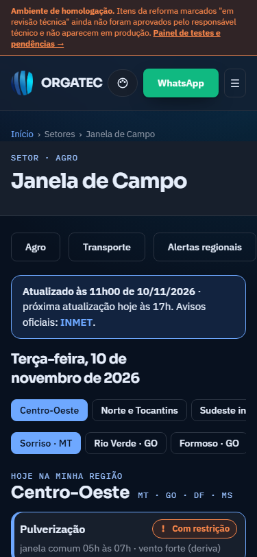
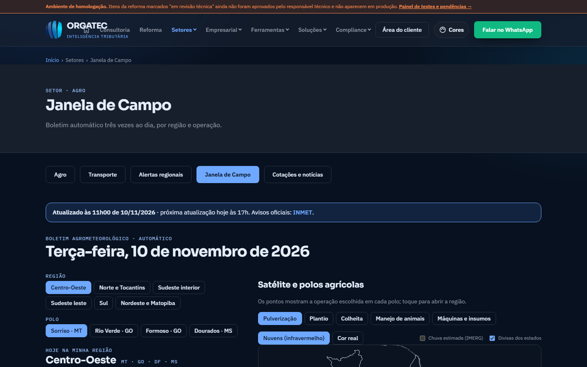

# Janela de Campo 2: o veredito primeiro, legível ao sol, uma só língua visual (planejamento)

- **Situação:** planejamento escrito em 10/11/2026, **aguardando aprovação**. Nenhum código foi alterado.
- **Branches previstas:** `ideia/campo-visual-1` a `ideia/campo-visual-4` (uma por fase, como nas Fases 0 a 6)
- **Prévia:** ainda não existe. Cada fase gera a sua com `python tools/previa.py`.
- **Relatório da sessão que originou este plano:** [relatorio-sessao-boletim-campo-2026-11.md](../relatorio-sessao-boletim-campo-2026-11.md)





## 1. Ponto de partida (medido no site no ar, 10/11/2026)

As Fases 0 a 6 resolveram confiabilidade, conteúdo e ordem. O que falta é **linguagem visual**: a página ainda parece um relatório bem organizado, não uma ferramenta de decisão para quem está no campo.

| Medida | Valor hoje | Observação |
|---|---|---|
| Altura da página | 4.425 px (celular 375 px), 3.924 px (desktop 1440 px) | Fase 3 já derrubou de 14.092 px |
| Antes da 1ª operação, no celular | cabeçalho, trilha, título, 3 botões de setor, caixa de status de 94 px, data, 2 fileiras de chips | A decisão começa abaixo de 640 px (sem a faixa de homologação) |
| Altura dos chips de região e polo | 32 px | Passa no mínimo de 24 px do WCAG 2.2 AA; fica abaixo dos 44 px de dedo no campo |
| Tamanho dos rótulos | 11 e 12 px, em mono, maiúsculas com espaçamento (REGIÃO, POLO, 00h, 06h…) | Contraste bom (7,0:1 a 10,5:1); o problema é tamanho e ruído, não cor |
| Contraste do texto principal | 13,4:1 a 16,2:1 | Sem problema |
| Paleta ativa | Azul flutuante escuro (padrão do site) | Existe a clara `azul-fl` nas "Cores"; nunca testada com o boletim ao sol |
| Rolagem horizontal | nenhuma | A matriz "Comparar as regiões" tem `min-width: 680px` e rola dentro da própria caixa |

### O que o olhar atento vê na tela

1. **Não há uma resposta.** A página lista cinco operações, mas não diz "hoje, na sua região, dá para trabalhar até as 11h". O produtor tem de montar a conclusão.
2. **A janela é texto técnico.** "janela comum 05h às 07h · vento forte (deriva)". Os dados têm a janela hora a hora (`ops[op].porHora`, de 5h às 20h), mas ela só aparece em barras genéricas da aba Horas, para a região inteira.
3. **A orientação aparece longe do toque.** Tocar numa operação abre a orientação de segurança **abaixo da lista inteira** (cerca de 500 px adiante no celular).
4. **Os controles de local ocupam duas fileiras** e somem ao rolar.
5. **A matriz das regiões não cabe no celular** (680 px mínimos) e fica dentro de um `<details>` fechado.
6. **Tudo é igual em peso.** Rótulos mono, cards e abas têm a mesma intensidade; nada guia o olho para o estado.
7. **Dia inteiro igual.** Hoje (10/11) a pulverização está "com restrição" nas 6 regiões e plantio e máquinas "favorável" nas 6. A matriz vira um bloco uniforme e perde o valor (efeito dos limites ainda não revisados, V20; o visual não conserta isso e **não deve fingir que conserta**).
8. **Escuro só.** Ao sol, tela escura com texto cinza-azulado de 12 px é a pior combinação. A paleta clara existe, mas não é oferecida onde ela importa.
9. **Cartão do WhatsApp com outra cara.** `tools/cartao_campo.py` gera imagens 1080 × 1920 (status, stories, TikTok) que não repetem a página.

## 2. Regras que continuam valendo (não são decisões novas)

- **Sem verde e sem vermelho nos estados da Janela.** Estados usam azul e âmbar, com ícone e texto (regra registrada em `tools/cartao_campo.py` e na página). Este plano **mantém** isso: a diferenciação vem de forma, peso e posição, não de semáforo.
- Estado nunca só por cor: ícone + texto + cor. Movimento reduzido respeitado. Foco visível.
- Tokens em `D:\01_Projetos_Ativos\design-tokens\` (Azul flutuante escuro; Sora, IBM Plex Sans e IBM Plex Mono). Nada de cor nova fora dos tokens; rodar `python verificar.py` se um token mudar.
- CSP `script-src 'self'`, sem biblioteca externa de gráfico: SVG e CSS puros. O Tailwind varre `html` e `js`.
- Uma única chave de `localStorage` para o que a Janela lembra: `orgatec.campo` (o teste da política de privacidade confere).
- **Formato do boletim congelado durante a semana de sombra.** Todas as mudanças abaixo usam só campos que já existem (`regioes[].ops`, `polos[].ops[op].{estado,janela,tipoJanela,motivo,horasPrevistas,porHora}`, `polos[].horas`, `polos[].dias`, `semDados`, `alerta`, `proximaAtualizacao`). Assim `tools/comparar_sombra.py` continua dizendo "mesmo formato".
- **Limites agronômicos (V20) não mudam.** O visual não pode sugerir mais certeza do que o critério tem.
- Faixa de homologação do topo (cerca de 80 px) só existe fora de produção; medir com e sem ela.

## 3. Princípios do novo visual

1. **Veredito antes de detalhe.** Primeira tela = resposta; o resto é prova.
2. **Densidade de dado, não de decoração** (Data-Density): glifos, faixas horárias e números tabulares no lugar de parágrafos.
3. **Um olhar basta.** Cada operação tem forma própria de estado: favorável = cheio e firme; com restrição = vazado com marca; evitar = hachurado; sem previsão = pontilhado. Funciona em escala de cinza.
4. **Dedo, não mouse.** Alvos de 44 px no celular, 48 px nos cartões de operação; polegar alcança tudo na metade de baixo da tela.
5. **Legível ao sol.** Modo claro de alto contraste ao alcance de um toque, sem exigir ir às "Cores".
6. **A mesma linguagem em todo lugar:** página, cartão do WhatsApp, imagem de compartilhamento.
7. **Honestidade visual.** Boletim vencido ou sem dado não mostra veredito.

## 4. O que muda, bloco a bloco

### 4.1 Primeira tela (celular)

```
HOJE (4.425 px)                          PROPOSTO
┌──────────────────────────┐             ┌──────────────────────────┐
│ ORGATEC        [Zap][≡]  │             │ ORGATEC        [Zap][≡]  │
│ Início › Setores › Janela│             │ Janela de Campo     Agro ▾│  ← título + setor numa linha
│ SETOR · AGRO             │             ├──────────────────────────┤
│ Janela de Campo          │             │ ● Vigente · 11h00 → 17h  │  ← status em 1 linha (44 px)
│ [Agro][Transporte][Alert]│             │ Ter 10/11 · Sorriso, MT ▾│  ← local sticky (abre seletor)
│ ┌──────────────────────┐ │             │                          │
│ │ Atualizado às 11h00… │ │             │ Hoje dá para trabalhar   │
│ └──────────────────────┘ │             │ até as 11h               │  ← VEREDITO (Sora 28 px)
│ Terça-feira, 10 de nov.  │             │ 2 de 5 operações        │
│ [Centro-Oeste][Norte e…] │             │ favoráveis · melhor      │
│ [Sorriso][Rio Verde][F…] │             │ janela 05h–11h           │
│ HOJE NA MINHA REGIÃO     │             │ [✓ Plant.][✓ Máq.][! Pul]│  ← 5 glifos de estado
│ Centro-Oeste  MT·GO·DF·MS│             │ [! Colh.][! Anim.]       │
│ Pulverização  ! Restrição│             ├──────────────────────────┤
│ janela comum 05h às 07h… │             │ Pulverização   ! Restrição│  ← cartão de operação
└──────────────────────────┘             │ ▮▮▮▮▮▮▯▯▯▯▯▯▯▯▯▯  05–11h │     com faixa horária 5h–20h
   (1ª operação a ~720 px)               └──────────────────────────┘
                                            (1ª operação a ≤ 560 px)
```

- **Cabeçalho da página enxuto:** trilha e título em uma linha; os atalhos de setor (Agro, Transporte, Alertas regionais, hoje uma fileira de 3 botões antes do status) ficam numa fileira mais baixa ou descem para o fim do conteúdo no celular; como é um componente compartilhado entre setores, isso é decidido na V0. A faixa de homologação, quando existir, fica fora da conta.
- **Status em uma linha:** ponto de estado + "Vigente · atualizado 11h00 · próxima 17h". Em vez da caixa de 94 px. Vencido ou sem dado: a linha muda de cor e de texto (ver 4.7).
- **Barra de local fixa (sticky):** "Terça 10/11 · Sorriso, MT ▾". Toque abre uma folha com regiões e polos em lista de 48 px (e busca por município, que já era item futuro da Fase 3). Ao rolar, a barra encolhe e carrega os cinco glifos do veredito, para o produtor não perder o contexto ao ler as abas.
- **Veredito do dia:** frase gerada no navegador a partir dos dados da região e do polo escolhidos. Exemplos: "Hoje dá para trabalhar até as 11h", "Dia difícil: só plantio e máquinas estão favoráveis". Sempre com a contagem ("2 de 5 operações favoráveis") e a fonte ("previsão por ponto, MET Norway"). Se a pessoa escolheu uma atividade em "Minha atividade" e ela tem operação correspondente, o veredito fala dessa operação primeiro.

### 4.2 Cartão de operação

- **Faixa horária de 5h às 20h** (16 células de `porHora`): cheia = favorável, vazada = restrição, hachurada = evitar, pontilhada = sem previsão. Marca de "agora" quando o boletim está vigente. Para a região (que só traz texto), a faixa é a interseção das faixas dos polos, calculada no cliente.
- **Número grande de janela:** "05–11h" em IBM Plex Mono tabular, 20 px; "melhor horário" em vez de "janela comum".
- **Motivo em uma linha**, em português corrente: "calor evapora a calda" no lugar de "calor (evaporação)" só se a regra tiver redação revisada; caso contrário, o motivo atual.
- **Orientação em acordeão no próprio cartão** (toque abre ali, não 500 px depois). Mantém o padrão `aria-expanded`.
- Peso visual por estado: favorável com borda e fundo `brand-soft`; restrição com borda `warn`; evitar com listra diagonal; nada de semáforo.

### 4.3 Comparar as regiões

A matriz de 680 px vira uma **grade de glifos**: 6 regiões × 5 operações, cada célula só com o glifo de estado (28 px) e o rótulo curto na primeira linha. Cabe em 375 px sem rolagem, fica aberta no desktop e recolhida no celular. Tocar numa linha troca a região. Quando as 6 regiões têm o mesmo estado numa coluna, a coluna ganha o texto "igual em todas" em vez de repetir seis glifos.

### 4.4 Aba Horas e aba 7 dias

- **Linha do dia em SVG**, sem biblioteca: temperatura (linha), chuva (barras) e vento (traço), com sombreado nas horas favoráveis da operação escolhida e a marca "agora". Tabela equivalente escondida para leitor de tela.
- **7 dias com ícones de tempo** (sol, parcial, nublado, chuva, chuva forte, trovoada) no lugar de só texto. **Decisão de licença:** desenhar um conjunto próprio de 8 SVGs, ou usar os símbolos oficiais do MET Norway (fonte dos dados) depois de conferir a licença na página deles. Hoje não conferi; não vou assumir.
- Rótulos de eixo de 11 para 13 px.

### 4.5 Tipografia e alvos de toque

- Rótulos funcionais (REGIÃO, POLO, CONDIÇÃO AO LONGO DO DIA) saem do mono maiúsculo de 11–12 px para IBM Plex Sans 13–14 px, peso 600, caixa normal. **Mono só para número** (horas, temperatura, mm, km/h), com `font-variant-numeric: tabular-nums`.
- Hierarquia de 4 níveis: veredito (Sora 28–32), título de bloco (Sora 20), texto (Plex Sans 15–16), apoio (Plex Sans 13).
- Chips e abas: 32 px para 44 px de altura no celular; 40 px no desktop.

### 4.6 Modo "ao sol"

- Botão "Ao sol" na barra de local, que aplica a paleta clara `azul-fl` e grava na chave que o site já usa (`orgatec.tema`). Nada novo no `localStorage`.
- **Antes de oferecer, medir.** Na `azul-fl` o contraste do texto de apoio é 5,0:1 a 5,7:1 e do âmbar de restrição sobre o seu fundo suave é **4,22:1**, abaixo de 4,5:1. Se o teste confirmar, o âmbar do estado "restrição" nessa paleta escurece (ajuste só no escopo da Janela, via variável local), sem mexer nos tokens globais.
- Sugerir o modo ao sol é decisão sua: só por toque (padrão deste plano) ou automático por `prefers-contrast` / `prefers-color-scheme`.

### 4.7 Estados que não podem enganar

| Situação | Hoje | Proposto |
|---|---|---|
| Boletim vigente | caixa azul | ponto de estado + linha curta |
| Boletim vencido (mais de 18 h, `LIMITE_HORAS`) | caixa âmbar "desatualizado" | **sem veredito**, glifos em cinza, texto "Sem veredito: boletim com mais de 18 h. Veja o aviso do INMET." |
| Polo ou horas sem previsão (`semDados`, `horasPrevistas` baixo) | texto no status | células pontilhadas na faixa; veredito diz "com previsão parcial (11 de 16 horas)" |
| Falha na imagem do satélite | aviso com "Tentar de novo" | igual (Fase 5), no mesmo estilo de aviso |
| Trovoada | caixa de alerta no meio da página | faixa fixa no topo da página, acima do veredito |

### 4.8 Satélite e mapa

Mantidos (Fase 5). Só alinhar: legenda e controles com os mesmos alvos de 44 px, "Cor real / Nuvens" como chips do mesmo componente, e o glifo de estado dos polos igual ao novo (forma, não só cor).

### 4.9 Cartão do WhatsApp e imagem de compartilhamento

- `tools/cartao_campo.py` passa a desenhar o **veredito primeiro** (mesma frase e mesmos cinco glifos da página), depois a matriz região × operação, a hora de emissão e a fonte (MET Norway, CC BY 4.0, crédito obrigatório). Continua sem gerar cartão de boletim vencido e continua retirando o do dia anterior.
- Botão "Compartilhar no WhatsApp" ao lado do veredito: abre `wa.me` com o texto do veredito e o link da página. É só um link; não coleta nada e não muda a CSP.

### 4.10 Cabeçalho do site (fora do boletim, mas aparece nele)

No desktop o ícone "Início" fica sobre a palavra ORGATEC. Confirmado em três páginas em 10/11/2026. Fica registrado como defeito separado, a corrigir antes ou junto com a Fase V1 porque é a primeira coisa que se vê acima do boletim.

## 5. Fases

Mesmo fluxo das Fases 0 a 6: branch por fase, prévia, "Seguir para a Fase N", junção na `desenvolvimento`, publicação só com `python tools/publicar.py` e a sua autorização.

| Fase | Entrega | Arquivos principais | Pronto quando |
|---|---|---|---|
| **V0. Decisões e mockup** | Mockup do celular e do desktop no Figma (regra do @Beta: projetar antes de codar), 2 opções de primeira tela, e as decisões da seção 7 | Figma; este documento | Você escolhe a opção e responde as decisões |
| **V1. Primeira tela** | Cabeçalho enxuto, status em 1 linha, barra de local sticky com folha de seleção, veredito, glifos de estado | `tools/gerar_paginas.py` (`janela_de_campo`), `site/assets/js/campo.js`, novo `campo-veredito.js`, `orgatec.css` | Veredito visível a ≤ 560 px no celular; 1ª operação a ≤ 640 px; veredito idêntico aos dados em teste |
| **V2. Operações e regiões** | Cartão com faixa horária e acordeão, grade de glifos das regiões, estados de vencido e sem dado | `campo.js`, `campo-regras.js`, `orgatec.css` | Sem rolagem horizontal em 320, 375, 768 e 1280 px; vencido nunca mostra veredito |
| **V3. Horas, 7 dias, tipografia, ao sol** | Linha do dia em SVG, ícones de tempo, rótulos 13 px, alvos de 44 px, modo ao sol com contraste medido | `campo.js`, `orgatec.css`, ícones | Contraste ≥ 4,5:1 (texto) e ≥ 3:1 (componentes) nas duas paletas; alvos ≥ 44 px no celular |
| **V4. Cartão e compartilhamento** | `cartao_campo.py` no estilo novo, botão de WhatsApp, OG da página | `tools/cartao_campo.py`, `tools/gerar_paginas.py` | Cartão e página dizem a mesma frase; testes do cartão passam |
| **V5 (opcional). Sem internet** | Guardar a última Janela para abrir sem sinal | service worker, `firebase.json` | Só se você quiser; ver riscos |

Cada fase atualiza os testes e2e que dependem do layout atual (primeira operação até 812 px, página até 5.000 px, abas por teclado, satélite sob demanda, desktop em duas colunas) e acrescenta:

- veredito igual à regra, para vários boletins de exemplo (todos favoráveis, todos com restrição, `semDados`, vencido);
- nenhum elemento interativo com menos de 44 px no celular;
- nenhuma rolagem horizontal da página;
- contraste medido nas duas paletas;
- movimento reduzido sem animação;
- a chave de `localStorage` continua sendo só `orgatec.campo` (e `orgatec.tema` para o modo ao sol).

## 6. Metas de medição (Playwright, dados reais, 375 × 812 e 1440 × 900)

| Medida | Hoje | Meta |
|---|---|---|
| Veredito visível no celular | não existe | até 560 px |
| Topo da 1ª operação, celular | cerca de 640 px (sem faixa de homologação) | até 640 px, com veredito antes dela |
| Altura da página, celular | 4.425 px | até 4.000 px |
| Rolagem horizontal (320 a 1280 px) | nenhuma | nenhuma, inclusive na grade das regiões |
| Alvo de toque mínimo, celular | 32 px | 44 px |
| Menor texto funcional | 11 px | 13 px |
| Contraste do âmbar de restrição na paleta clara | 4,22:1 | ≥ 4,5:1 |
| Imagens do satélite no celular antes de abrir a aba | 0 | 0 |

## 7. Decisões que são suas

1. **Veredito:** contar operações ("2 de 5 favoráveis") ou falar sempre da atividade escolhida em "Minha atividade"? Proposta: atividade escolhida quando houver, contagem quando não.
2. **Forma dos estados** (cheio, vazado, hachurado, pontilhado) mantendo a regra "sem verde e sem vermelho": confirma? Se quiser rever a regra, é uma decisão à parte, que também mexe no cartão do WhatsApp.
3. **Modo ao sol:** só por toque, ou também automático por preferência do aparelho?
4. **Ícones de tempo:** conjunto próprio ou símbolos do MET Norway (depende de eu conferir a licença).
5. **Compartilhar no WhatsApp:** com o texto do veredito. Entra?
6. **Sem internet (V5):** vale a complexidade? Traz risco de cache de boletim velho; precisa ser desenhado com o publicador e a trava do veredito vencido.
7. **Ordem:** começar por V1 (primeira tela) como proposto? Ou o cabeçalho do site (4.10) antes de tudo?

## 8. Riscos e cuidados

- **Veredito é uma afirmação.** Por isso nasce dos mesmos estados que já aparecem, nunca de regra nova, e some quando o boletim vence. Enquanto os limites agronômicos (V20) não forem revisados, o veredito herda a limitação deles; o texto de fonte e a seção "Como decidimos" ficam um toque abaixo.
- **Semana de sombra.** Nada aqui muda o formato do JSON. Se uma fase precisar de campo novo (por exemplo, janela estruturada por região), ela atualiza `tools/comparar_sombra.py` no mesmo commit e avisa antes.
- **Peso da página.** Sem biblioteca nova; os SVGs são inline ou arquivos pequenos. Medir o tamanho dos arquivos de cada fase.
- **Acessibilidade.** Glifos com texto alternativo; linha do dia com tabela equivalente; foco visível; ordem de tabulação igual à visual.
- **Testes de e2e dependem do layout** e vão quebrar de propósito; atualizar junto, não depois.
- **Mudança de hábito.** Quem já usa a Janela está acostumado com a ordem atual. A Fase V1 mantém os mesmos rótulos "Hoje na minha região" e "Comparar as regiões" para não desorientar.

## 9. Fora deste plano

Resumo da atividade com cotação e notícia dentro da Janela (depende de juntar `noticias.json` e o CEPEA, D21), mudança nos limites agronômicos (V20), mudança da publicação do boletim para o GitHub (ver relatório, seção 6) e a correção do cabeçalho do site (4.10), que é defeito separado.
