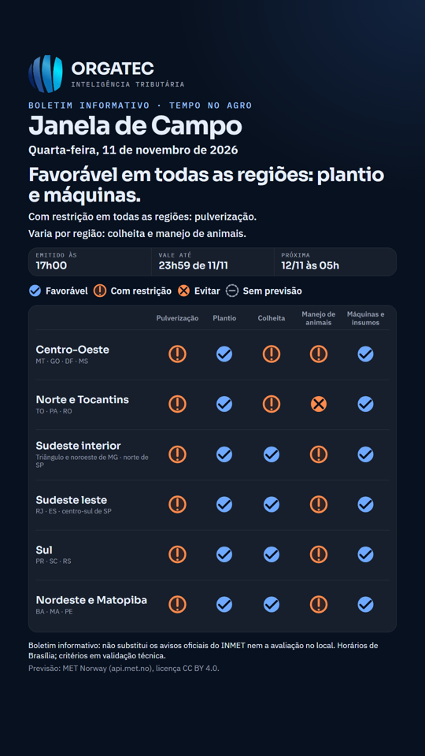
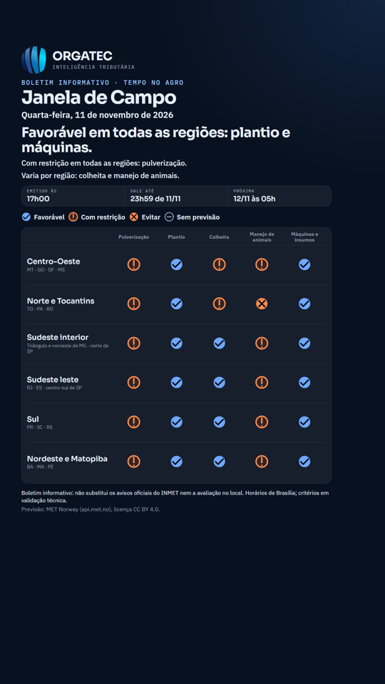

# Janela de Campo 2, V4: cartão das redes com o veredito e botão de compartilhar no WhatsApp

- **Situação:** implementada em 11/11/2026 na branch `ideia/campo-visual-4`; **aguarda a sua aprovação**. Não publicada.
- **Branch:** `ideia/campo-visual-4` (parte da `desenvolvimento`, com V1 a V3 já juntas)
- **Plano e mockups:** [campo-visual-2.md](campo-visual-2.md) (seção 4.9)
- **Prévia:** do site, com o botão: a gerar depois da sua autorização. O cartão tem imagens de exemplo (ver "Como ver o cartão").

## O que muda

### Cartão do status do WhatsApp, dos stories e do TikTok (`tools/cartao_campo.py`)

1. **O veredito vem primeiro**, logo abaixo do título e do dia: "Favorável em todas as regiões: plantio e máquinas.", "Com restrição em todas as regiões: pulverização.", "Varia por região: colheita e manejo de animais." O cartão não tem um polo, então o veredito é do boletim inteiro: o que é igual em todas as regiões é dito uma vez, e o que varia aponta para a tabela. A regra é a mesma da grade das regiões da página e mora no mesmo arquivo (`site/assets/js/campo-veredito.js`, função `vereditoDasRegioes`): o Python a chama pelo Node, como já fazia com `campo.js`, para os dois nunca divergirem.
2. **Mesma linguagem de estados da página**: glifos cheios com ✓, vazados com !, cheios com ✕ e pontilhados com – (antes eram retângulos coloridos). A legenda tem os quatro, inclusive "Sem previsão", e a tabela mostra "sem previsão" quando a região não tem nenhuma hora útil na operação.
3. **Folga reorganizada** para caber na área segura de cada rede (WhatsApp, stories e TikTok) com o veredito: título e linhas de apoio menores e tabela mais compacta. O teste de área segura continua valendo, inclusive com o alerta de trovoada em quatro regiões (pior caso).

### Página: botão "Compartilhar no WhatsApp"

Abaixo do veredito (só com boletim em dia; boletim vencido ou desatualizado não tem botão, nem veredito). É um link para `wa.me` com o texto pronto: título em negrito (local e data), veredito, as restrições com o melhor horário, "Previsão: MET Norway. Não substitui os avisos oficiais do INMET." O **endereço do site só entra com o site em produção**, a mesma regra das peças do marketing. O link só abre a conversa: nada é enviado sozinho e nada é coletado.

### Para baixar a altura da página

O botão somou cerca de 50 px e passou do teto de 5.000 px que um teste da Fase 3 guarda. Em vez de subir o teto, as **duas barras antigas da aba Horas** (por período da região e hora a hora do polo) agora ficam num bloco recolhido, "Detalhes por período e por hora": fechado no celular, aberto no desktop. Era a medida que eu tinha sugerido ao fim da V3; está feita aqui para destravar, e se preferir voltar a mostrá-las sempre é uma linha.

## O que não muda

Formato do boletim (JSON), regras e limites (V20), regras do cartão (sem verde nem vermelho, crédito do MET Norway, sem endereço em homologação, retirada do cartão vencido), arquivo de 7 dias no PC, satélite e as demais fases.

## Como ver o cartão

O cartão é uma imagem gerada a cada rodada do boletim (`site/dados/campo/cartao-status.png` e `cartao-tiktok.png`); a prévia do site não os mostra. As imagens de exemplo, geradas com o boletim real de 11/11/2026, estão em `docs/ideias/campo-visual-4/`.

 

## Medição (boletim real de 11/11/2026)

| | Antes (no ar) | V3 | V4 |
|---|---|---|---|
| Altura da página, celular | 4.425 px | 5.090 px | **4.906 px** |
| Veredito, celular (topo, com a faixa de homologação de 80 px) | não existia | 440 px | 440 px |
| Primeira operação, celular (topo, com a faixa) | 718 px | 784 px | **836 px** |
| Rolagem horizontal | nenhuma | nenhuma | nenhuma |

A página baixou 184 px em relação à V3 (as duas barras antigas recolhidas), mas **continua acima dos 4.425 px do que está no ar** e da meta de 4.000 px do plano. A primeira operação desceu mais 52 px porque o botão de compartilhar fica entre o veredito e os cartões. Se isso incomodar, o botão pode ir para depois dos cartões ou para a barra do local.

## Testes

- Unitários (+3): `vereditoDasRegioes` (igual, varia, uma região, nenhuma, sem previsão).
- pytest (+2): o cartão traz o veredito antes da tabela e usa os glifos da página; sem regiões não quebra.
- E2E (+2): o botão leva o veredito e o site só em produção; boletim vencido não tem botão. Os testes de área segura do cartão e de altura da página continuam verdes.

## Fora desta fase

Imagem de compartilhamento (OG) própria da Janela: o site é estático e o cartão muda 3 vezes ao dia; apontar o OG para ele deixaria a prévia dos links quebrada nas horas em que o cartão é retirado. Fica como ideia. Modo offline (V5, opcional).

## Pronto quando

Suíte completa e bandit verdes; imagens de exemplo e prévia do site vistas e aprovadas.
